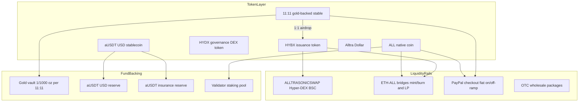

# Alltra Tokens, Funds & Liquidity Report

**Report date:** 16 July 2026  
**Scope:** External Alltra blockchain ecosystem (Alltra SmartChain / ALLTRAVERSE)  
**Note:** Art City AI Studio contains no Alltra/blockchain integration. This is independent research.

## Live links

| Format | URL (local dev) |
|--------|-----------------|
| **Live page** | http://localhost:3000/reports/alltra |
| **PDF** | http://localhost:3000/reports/alltra-report.pdf |
| **HTML** | http://localhost:3000/reports/alltra-report.html |
| **Markdown** | http://localhost:3000/reports/alltra-report.md |

Start the frontend with `npm run dev` in `frontend/`, then open the live page link above.

---

## Executive Summary

The Alltra ecosystem is an EVM-compatible DPoS blockchain (chain ID `651940`) built around gold-backed **11::11**, issuance token **HYBX**, native **ALL**, DEX governance **HYDX**, and USD stablecoin **aUSDT**. Funds flow through gold vaults, dual USD reserves, validator staking, fiat PayPal rails, and several bridge/LP contracts.

**Key findings (live data, 16 Jul 2026):**

| Metric | Value | Source |
|--------|-------|--------|
| ALL price (explorer) | **$0.01116** | [alltra.global/api/v2/stats](https://alltra.global/api/v2/stats) |
| ALL market cap (explorer) | **~$1.84B** | Same |
| Network addresses | **18,898** | Same |
| aUSDT on-chain supply (primary contract) | **~6.16B** | [alltra.global/api/v2/tokens](https://alltra.global/api/v2/tokens) |
| aUSDT NSB reserve backing (API) | **~25.16B** | [nsb-ausdt-reserve API](https://alltra.azurewebsites.net/api/nsb-ausdt-reserve) |
| USD cash reserve (API) | **$625.7B** | Same |
| HYBX/ALL bridge LP (native ALL) | **~164.4M ALL** | Alltra RPC |
| Temp LP EOA (native ALL) | **~12.2M ALL** | Alltra RPC |
| External CEX liquidity (ALL) | **Very thin** (~$166–$223/day on Dex-Trade) | Coinranking |

**Top risks:** Price data disagrees sharply across sources; liquidity is concentrated in a few EOAs; fiat rails remain in test mode ($50/day); multiple aUSDT contract addresses exist on-chain; aUSDT reserve claims require independent audit.

---

## 1. Network Foundation

| Property | Value |
|----------|-------|
| Chain | Alltra Mainnet (EVM-compatible DPoS) |
| Chain ID | `651940` |
| Native token | **ALL** |
| Block time | ~9 seconds (docs); ~3s average per explorer stats |
| Gas price | 0 gwei |
| RPC | `https://mainnet-rpc.alltra.global/` |
| Explorer | [alltra.global](https://alltra.global) |
| Block height (live) | **35,375,576** |
| Total blocks | **35,375,418** |
| Transactions today | **1,526** |

### Staking / validator fund pool

| Parameter | Value |
|-----------|-------|
| Max validators | 60 (docs also cite 100 in one section) |
| Min stake | 100,000 ALL |
| Max stake | 5,000,000 ALL |
| Validator fee | 15% |
| Inflation APY | ~5% |
| Active validators (public) | 28 |
| Delegators (public) | 1,565 |
| Memberships (public) | 17,825 |

Annual emission cited in tokenomics: **~50B ALL/year** distributed via validators. Rewards-admin contracts are documented as **not live**.

---

## 2. Token Registry

### 2.1 Core ecosystem tokens

| Token | Symbol | Role | Decimals | Contract (Alltra mainnet) | Holders (live) | Total supply (live) |
|-------|--------|------|----------|---------------------------|----------------|---------------------|
| **ALL** | ALL | Native gas, staking, marketplace | 18 | Native (`651940`) | — | Inflationary (10T max cited on CEX trackers) |
| **11::11** | 11::11 | Gold-backed stable (1/1000 oz gold) | 18 | `0xB6a67342C40326E41BE964D0DF4D042D1fBfdf49` | 551 | **100.00055** |
| **HYBX** | HYBX | Issuance / barter / marketplace | 8 | `0x1839f77eBed7F388c7035f7061B4B8Ef0E72317a` | 531 | **~401.18B** |
| **HYDX** | HYDX | Hyper-DEX governance | 18 | `0x0d9793861AEB9244AD1B34375a83A6730F6AdD38` | 167 | **~43.91M** |
| **aUSDT** (primary) | USDT | USD stablecoin (NSB/Monza) | 18 | `0x66D8Efa0AF63B0e84eb1Dd72bf00f00cd1e2234e` | 10,991 | **~6.16B** |
| **WALL** | WALL | Wrapped Alltra | 18 | `0x2da2b8f961F161ab6320acB3377e2e844a3C3ce4` | 207 | **~29.67B** |
| **Alltra Dollar** | — | Ecosystem dollar unit | — | Not fully enumerated | — | Referenced in docs only |

### 2.2 Cross-chain deployments

| Token | Ethereum | BSC |
|-------|----------|-----|
| HYBX | `0x32b29705BB44C57f6A3DcCa047Fd55b460977c25` | — |
| ALL (wrapped/bridged) | `0x2da2b8f961F161ab6320acB3377e2e844a3C3ce4` | `0x20d145fA3C7c62393fcf34E5A9c9c7B53468e18E` |

### 2.3 Related stablecoin stack

| Token | Manager / issuer | Backing claim | Notes |
|-------|------------------|---------------|-------|
| **aUSDT** | Monza Capital LLC + Niisitapi Sovereign Bank | 1 USD reserve + 1 USD insurance per token | Primary on-chain: `0x66D8...` |
| **aUSDT** (alt contract) | — | — | `0x015B1897Ed5279930bC2Be46F661894d219292A6` — **~535.56B supply**, 374 holders |
| **mzUSDT** | Monza Capital | 1:1 backed by aUSDT in Texas attorney escrow | Solana; 1B minted |
| **AUSDC** | — | — | `0xa95EeD79f84E6A0151eaEb9d441F9Ffd50e8e881` |
| **AUDA (MOOLA)** | — | — | `0x690740f055A41FA7669f5a379Bf71B0cDF353073` |

### 2.4 Liquidity pool tokens (on-chain)

| Token | Symbol | Contract | Holders | Supply |
|-------|--------|----------|---------|--------|
| HYDX LPs | HYDX-LP | `0x119751597FE282615ac8dd5323577cc9b2728102` | 5 | ~5.29M |
| HYDX LPs | HYDX-LP | `0xae9B16C50E5e11c0c7388e8289459f1Af1ae47a8` | 3 | ~3.16M |
| HYDX LPs | HYDX-LP | `0xC33F12b74D62205AF13b4908e4b8d2e684dA89a3` | 3 | ~35.4K |

### 2.5 Token relationships

```
11::11 (gold vault) ──1:1 airdrop──> HYBX (issuance)
ALL (native) ──staking──> Validator pool ──rewards──> Delegators
aUSDT ──dual reserve──> USD cash + USD insurance (NSB API)
HYBX / ALL ──bridges──> ETH cross-chain liquidity
HYDX ──governance──> ALLTRASONICSWAP Hyper-DEX (BSC)
```

---

## 3. Funds & Treasury Flows

### 3.1 Gold-backed reserves (11::11)

- **Backing:** 1 token = 1/1000 troy oz fine gold (Bougainville community gold project)
- **On-chain supply:** 100.00055 tokens (~0.1 oz gold equivalent at face value)
- **Issuance trigger:** Purchasing 11::11 mints HYBX 1:1 via airdrop protocol
- **Physical redemption:** Offered after 25 Dec 2025 per official FAQ
- **Custody:** Claimed vaulted and insured by Alltra (independent attestation recommended)

### 3.2 aUSDT reserve funds (live API — 16 Jul 2026)

Source: `https://alltra.azurewebsites.net/api/nsb-ausdt-reserve`

| Field | Value |
|-------|-------|
| aUSDT contract | `0x66D8Efa0AF63B0e84eb1Dd72bf00f00cd1e2234e` |
| NSB aUSDT reserve (on-chain raw) | 25,159,130,095.31 aUSDT |
| Pegging | 1 aUSDT = 1 USD |
| Primary cash reserve balance | **$625,735,000,000** |
| Primary backing allocated | $25,159,130,095.31 |
| Primary surplus | **$600,575,869,904.69** |
| Insurance reserve balance | **$625,735,000,000** |
| Insurance backing allocated | $25,159,130,095.31 |
| Insurance surplus | **$600,575,869,904.69** |

**Discrepancy note:** Explorer shows only **~6.16B** aUSDT on the primary contract, while the NSB API reports **~25.16B** in reserve backing. A second aUSDT contract (`0x015B...`) holds **~535.56B** supply. This requires reconciliation before relying on reserve figures.

### 3.3 Staking fund pool (ALL)

| Item | Detail |
|------|--------|
| Validator stake range | 100,000 – 5,000,000 ALL |
| Rent-to-own program | Investors advanced 5M ALL to stake |
| Annual emission | ~50B ALL/year (5% inflation model) |
| Rewards-admin | Documented as **not live** |

### 3.4 Fiat on/off-ramp funds (ALL + 11::11)

| Step | Mechanism |
|------|-----------|
| 1 | Auth0 KYC login |
| 2 | Tokens escrowed to smart contract with encrypted payload |
| 3 | Backend listener decrypts, applies slippage + exchange rate |
| 4 | PayPal payout to verified email |

**Current limits (test mode):** $50/day per whitelisted wallet, 1 transaction/day.

| Contract / EOA | Address | Role |
|----------------|---------|------|
| Fiat onboarding (ALL) | `0x967009c2124304B82585080bdC6c47cB7f9eE205` | On-chain fiat entry |
| PayPal webhook | `0xbF576101e52d08Bed0134FB0B64a1537e88dcC54` | Payment events |
| Checkout UI | [checkout.alltra.global](https://checkout.alltra.global) | Card/PayPal purchase |
| Temp LP EOA | `0x3022BCB959153982A477209CAFaEdD5186359882` | Referenced LP across rails |

### 3.5 OTC / wholesale entry points

| Program | Minimum investment |
|---------|-------------------|
| General 11::11 + HYBX airdrop | $125,000 AUD |
| Gold/precious metals supplier | 10 kg (gold/silver/platinum/copper) |
| Marketplace merchant | $89 AUD setup |
| Validator business | $225,000 AUD |
| Growth Business Package | $220/month |
| Premium Business Membership | $789/month |
| Validator-as-a-Business Package | $6,500/month |

### 3.6 Entity map

| Entity | Role |
|--------|------|
| **Ozz Metals Co. Pty Ltd** | Parent / gold project operator |
| **Monza Capital LLC** | aUSDT fund manager |
| **Niisitapi Sovereign Bank (NSB)** | aUSDT issuer / sovereign backing |
| **Go Gold Management** | 11::11 fractional gold distribution |
| **Validators (28 active)** | DPoS block production + staking rewards |

---

## 4. Liquidity Infrastructure

### 4.1 Hyper-DEX (ALLTRASONICSWAP)

- **URL:** [alltrasonicswap.trade](https://alltrasonicswap.trade)
- **Chain:** Binance Smart Chain
- **Governance:** HYDX token
- **Features:** Swaps, yield farming, community liquidity
- **Status:** Staking farms listed as "coming soon" on tokenomics page

### 4.2 Cross-chain bridges

| Bridge | Mechanism | Liquidity pools? | ETH address | ALL address |
|--------|-----------|------------------|-------------|-------------|
| HYBX bridge | Mint/burn | **No** | `0xdb181ba33031471bc366c29f113eaf9cd705eaee` | `0xDD94051679B1668566862738AB33A0f4956BbB19` |
| HYBX/ALL bridge | Pool-based | **Yes** | `0x96aac183AD10218055e0DEfB0596dFbB35407976` | `0x96aac183AD10218055e0DEfB0596dFbB35407976` |
| Exchange bridge | Cross-chain swap | LP via EOA | `0xeAc6A8eD48Ca8AE511AfB77181A8a8CbEB27bd49` | `0xeAc6A8eD48Ca8AE511AfB77181A8a8CbEB27bd49` |

### 4.3 Live LP balances (16 Jul 2026)

#### Native ALL balances (RPC)

| Address | Role | Native ALL balance |
|---------|------|-------------------|
| `0x96aac183AD10218055e0DEfB0596dFbB35407976` | HYBX/ALL bridge LP | **164,398,059.15 ALL** |
| `0x3022BCB959153982A477209CAFaEdD5186359882` | Temp LP EOA | **12,246,479.04 ALL** |

#### Temp LP EOA token holdings (explorer API)

| Token | Balance |
|-------|---------|
| 11::11 | **5,248,595.12** |
| AUSDT (alt `0x015B...`) | **2,147,903.43** |
| HYBX | **418,491,052.77** |
| HYDX | **98,150.97** |
| AUSDC | **96,576.28** |
| AUDA (MOOLA) | **98,898.00** |
| ChatCoin (CHT) | **29,999,885.76** |

### 4.4 Airdrop / dispensing contracts

| Contract | Address | Role |
|----------|---------|------|
| Airdrop minter | `0xa198A7ac5680AD72522C17430bE9c44b11140859` | Mints into global LP + user accounts |
| 11::11 transfer relay | `0x28cb43502C54565989632Cf9344f83273Da5A40A` | Airdrop dispensation logic |
| Validator allocation | `0xDb8e6E94Ec01ec43aD10a6008fB67092076eaE8B` | Validator airdrops |

### 4.5 External market liquidity (ALL)

| Source | Price | 24h volume | Liquidity | Notes |
|--------|-------|------------|-----------|-------|
| Alltra explorer | **$0.01116** | — | — | Mcap ~$1.84B |
| Coinranking | $0.000057 | ~$166–223 | — | Mcap ~$370K; Dex-Trade |
| LiveCoinWatch | $0.01004 | ~$29.4K | **~$18K (±2%)** | Extremely thin DEX depth |

**Wrapped ALL contracts for external trading:**
- ETH: `0x2da2b8f961F161ab6320acB3377e2e844a3C3ce4`
- BSC: `0x20d145fA3C7c62393fcf34E5A9c9c7B53468e18E`

### 4.6 HYBX market liquidity

- Official tokenomics cites ~$0.000161 USD (DEXTools reference)
- ETH contract: `0x32b29705BB44C57f6A3DcCa047Fd55b460977c25`
- No significant aggregated DEX liquidity found on major trackers
- Primary liquidity appears internal (bridge LPs, temp LP EOA, marketplace utility)

---

## 5. Architecture Diagram



---

## 6. Risks & Data Gaps

| Area | Finding | Severity |
|------|---------|----------|
| Price inconsistency | Explorer ($0.011), Coinranking ($0.000057), LiveCoinWatch ($0.010) disagree by 100–200x | High |
| aUSDT supply mismatch | Primary contract ~6.16B vs NSB API ~25.16B vs alt contract ~535.56B | High |
| Liquidity concentration | Temp LP EOA holds 7+ token types + 12.2M native ALL | High |
| Thin external markets | ALL DEX liquidity ~$18K; CEX volume ~$166/day | Medium |
| Fiat rails | Test mode only ($50/day); rewards-admin not live | Medium |
| Multiple aUSDT contracts | Two major aUSDT addresses with different supplies | Medium |
| dapps portal | [dapps.alltra.global](https://dapps.alltra.global) returned 503 during research | Low |
| Regulatory complexity | Ozz Metals, Monza Capital, NSB across multiple jurisdictions | Medium |
| Gold backing | 11::11 supply on-chain is only 100 tokens; vault attestation not verified | Medium |
| Art City repo | Zero Alltra integration | N/A |

---

## 7. Verification Checklist

Before acting on any Alltra liquidity or funds data:

- [ ] Verify each contract on [alltra.global](https://alltra.global) (source code, holders, recent transactions)
- [ ] Reconcile aUSDT supplies across `0x66D8...`, `0x015B...`, and NSB reserve API
- [ ] Pull live aUSDT reserves from `https://alltra.azurewebsites.net/api/nsb-ausdt-reserve`
- [ ] Compare ALL price across explorer, DEX, and CEX listings
- [ ] Confirm bridge LP balances on both ETH and ALL sides at `0x96aac...`
- [ ] Audit temp LP EOA `0x3022...` token movements and authority
- [ ] Review KYC/fiat escrow contract events for actual payout volume
- [ ] Independently validate 11::11 gold-backing (audit docs, vault attestations)
- [ ] Verify mzUSDT escrow balance on Solana (Monza Dollar collateral)
- [ ] Confirm validator count and staking APR against on-chain data

---

## 8. Contract Address Appendix

### Core tokens (Alltra mainnet)

| Name | Address |
|------|---------|
| 11::11 | `0xB6a67342C40326E41BE964D0DF4D042D1fBfdf49` |
| HYBX | `0x1839f77eBed7F388c7035f7061B4B8Ef0E72317a` |
| HYDX | `0x0d9793861AEB9244AD1B34375a83A6730F6AdD38` |
| aUSDT (primary) | `0x66D8Efa0AF63B0e84eb1Dd72bf00f00cd1e2234e` |
| aUSDT (alt) | `0x015B1897Ed5279930bC2Be46F661894d219292A6` |
| WALL (Wrapped Alltra) | `0x2da2b8f961F161ab6320acB3377e2e844a3C3ce4` |
| AUSDC | `0xa95EeD79f84E6A0151eaEb9d441F9Ffd50e8e881` |
| AUDA (MOOLA) | `0x690740f055A41FA7669f5a379Bf71B0cDF353073` |

### Cross-chain

| Name | Chain | Address |
|------|-------|---------|
| HYBX | Ethereum | `0x32b29705BB44C57f6A3DcCa047Fd55b460977c25` |
| ALL/WALL | BSC | `0x20d145fA3C7c62393fcf34E5A9c9c7B53468e18E` |

### Bridges

| Name | ETH | ALL |
|------|-----|-----|
| HYBX bridge | `0xdb181ba33031471bc366c29f113eaf9cd705eaee` | `0xDD94051679B1668566862738AB33A0f4956BbB19` |
| HYBX/ALL bridge (LP) | `0x96aac183AD10218055e0DEfB0596dFbB35407976` | `0x96aac183AD10218055e0DEfB0596dFbB35407976` |
| Exchange bridge | `0xeAc6A8eD48Ca8AE511AfB77181A8a8CbEB27bd49` | `0xeAc6A8eD48Ca8AE511AfB77181A8a8CbEB27bd49` |

### Fiat / operations

| Name | Address |
|------|---------|
| Fiat onboarding | `0x967009c2124304B82585080bdC6c47cB7f9eE205` |
| PayPal webhook | `0xbF576101e52d08Bed0134FB0B64a1537e88dcC54` |
| Temp LP EOA | `0x3022BCB959153982A477209CAFaEdD5186359882` |
| Airdrop minter | `0xa198A7ac5680AD72522C17430bE9c44b11140859` |
| 11::11 relay | `0x28cb43502C54565989632Cf9344f83273Da5A40A` |
| ETH onboarding relay EOA | `0x3b1b25cA01Fb2E04607881a5e85A7004e5Bb258C` |
| Fiat relay + ALL LP EOA | `0x1B924F2909129E6c34b8706E8BB170D732E25Ab4` |

### Operational EOAs (from tokenomics docs)

| EOA | Role |
|-----|------|
| `0x461510a59B9810139eb24170a85507798839d9F0` | HYBX-HYBX and HYBX-ALL operations |
| `0x7f745445C9f4D98CE48280390c8ba9B9370ec19a` | Exchange bridge ETH→ALL relay |
| `0x3D30E0170985a779B85afC69d57d36eb351554aA` | setExchangeRate on 11::11 |
| `0xDb8e6E94Ec01ec43aD10a6008fB67092076eaE8B` | Validator allocation airdrops |

---

## 9. Sources

| Source | URL |
|--------|-----|
| Alltra tokenomics | https://alltra.world/p/hyper-barter-exchange-tokenomics. |
| 11::11 coin | https://alltra.world/11::11coin |
| Network docs | https://docs.alltra.global/general-1/network-details/fuse-network-mainnet |
| Explorer stats API | https://alltra.global/api/v2/stats |
| Explorer tokens API | https://alltra.global/api/v2/tokens |
| NSB aUSDT reserve API | https://alltra.azurewebsites.net/api/nsb-ausdt-reserve |
| Monza Capital aUSDT | https://www.monza.capital/ausdt |
| Monza Dollar (mzUSDT) | https://monzausdt.com/about/ |
| NSB press release (PDF) | https://www.niisitapicb.com/_files/ugd/a6d7cc_c8fec480275947929f4e46a725c48fa0.pdf |
| Coinranking (ALL) | https://coinranking.com/coin/xUaXbcubt+alltracoin-all |
| LiveCoinWatch (ALL) | https://www.livecoinwatch.com/price/AlltraCoin-___ALL |
| Hyper-DEX | https://alltrasonicswap.trade |
| Checkout | https://checkout.alltra.global |

---

*This report is for informational purposes only. It does not constitute financial, legal, or investment advice. All on-chain and API figures should be independently verified before any financial decision.*
